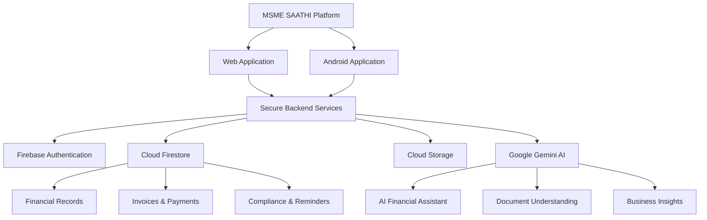

# 🚀 MSME SAATHI
### Your Intelligent Business Companion for Finance, Compliance & Growth

  <strong>Empowering India's MSMEs with AI-driven financial intelligence.</strong>

  <em>Manage smarter. Stay compliant. Grow confidently.</em>

---

## 🌟 About the Project

**MSME SAATHI** is an AI-powered financial management and compliance platform designed to simplify the way Micro, Small and Medium Enterprises (MSMEs) manage their businesses.

Running a small business involves much more than selling products or providing services. Business owners must manage invoices, track payments, monitor expenses, maintain financial records, understand compliance requirements, and explore opportunities for financial assistance.

For many MSMEs, these responsibilities are complicated, time-consuming, and difficult to manage through disconnected tools.

**MSME SAATHI brings these essential business activities together in one intelligent digital platform.**

With an integrated AI assistant, financial insights, compliance awareness, loan-readiness guidance, and business management tools, MSME SAATHI aims to make professional business management more accessible to every entrepreneur.

---

## 💡 The Problem We're Solving

Many Indian MSMEs face challenges such as:

- 📉 Limited visibility into their financial performance.
- 🧾 Manual invoice creation and payment tracking.
- 💸 Difficulty monitoring expenses and cash flow.
- 📅 Missing important compliance deadlines.
- 🏦 Challenges preparing financial information for loan applications.
- 🔍 Lack of awareness about relevant government schemes.
- 📂 Financial documents scattered across different platforms.
- 🤝 Limited access to affordable financial guidance.

These challenges can affect productivity, financial planning, and business growth.

## ✨ Our Solution

MSME SAATHI provides a centralized platform that combines financial management, AI assistance, compliance awareness, and business insights.

Instead of switching between multiple applications, business owners can manage important business activities from a single dashboard.

The platform is designed for both **Web and Android**, making essential business information accessible wherever entrepreneurs need it.

---

## 🔥 Key Features

### 📊 1. Smart Financial Dashboard
- Overview of business income and expenses.
- Financial performance visualization.
- Outstanding payment tracking.
- Cash flow insights.
- Interactive charts and reports.

### 🧾 2. Invoice Management
- Create and manage business invoices.
- Maintain customer information.
- Track paid, unpaid, and pending invoices.
- Generate downloadable invoice documents.
- Maintain organized invoice records.

### 💰 3. Expense & Transaction Management
- Record daily business expenses.
- Categorize transactions.
- Monitor business spending.
- Maintain financial transaction history.
- Understand spending patterns.

### 🤖 4. AI Financial Assistant
Powered by Google Gemini, the AI assistant aims to make financial information easier to understand.

It can help users:
- Understand financial summaries.
- Ask questions about business finances.
- Interpret business trends.
- Receive practical financial management suggestions.
- Understand relevant financial and compliance concepts.
- Get assistance with business documents.

### 📋 5. Compliance Management
- Organize important business documents.
- Track relevant compliance requirements.
- Receive deadline reminders.
- Improve awareness of GST and Udyam-related processes.
- Access guidance through relevant official resources.

### 🏦 6. Loan Readiness Assessment
Help business owners prepare for financial assistance by:
- Reviewing relevant business financial information.
- Identifying potentially missing documents.
- Understanding financial preparedness.
- Receiving suggestions to improve loan readiness.

*MSME SAATHI does not guarantee loan approval or replace an official lender's credit assessment.*

### 🇮🇳 7. Government Schemes & Financial Assistance
- Discover relevant MSME support programmes.
- Explore government financial assistance opportunities.
- Understand scheme requirements.
- Access information from official government resources.

### 📁 8. Document Management & Reports
- Centralized document organization.
- Financial record management.
- Business performance reports.
- Easier access to important business information.

---

## 🎯 What Makes MSME SAATHI Different?

| Traditional Business Management | MSME SAATHI |
|---|---|
| Disconnected business tools | Unified business platform |
| Manual financial tracking | Organized financial management |
| Difficult-to-understand financial data | AI-assisted explanations |
| Scattered business documents | Centralized document management |
| Limited compliance awareness | Compliance guidance and reminders |
| Unclear loan preparation | Loan-readiness guidance |
| Difficult scheme discovery | Government scheme information |

**Our focus is not simply digitizing business records. It is making business information more useful, understandable, and actionable.**

---

## 🧠 Technology Stack

The project is designed around modern, scalable technologies.

| Layer | Technology |
|---|---|
| Web Application | React + TypeScript |
| UI & Styling | Tailwind CSS |
| Charts & Analytics | Recharts |
| Icons | Lucide |
| Android Application | Kotlin + Jetpack Compose |
| Backend Services | Node.js |
| Authentication | Firebase Authentication |
| Database | Cloud Firestore |
| File Storage | Firebase Cloud Storage |
| AI Integration | Google Gemini |
| Deployment | Firebase Hosting / Google Cloud Run |

---

## 🏗️ System Architecture

MSME SAATHI follows a shared-backend approach so that its web and Android applications can work with the same business data.

### 🔐 Security & Data Protection

Security and responsible data handling are important parts of the platform's design.

- Authentication-based access.
- Business-specific data isolation.
- Server-side authorization for protected operations.
- Secure handling of API credentials.
- Private document storage.
- Access controls for business information.
- Audit-friendly financial record management.

---

## 🌍 Designed for Indian MSMEs

MSME SAATHI focuses on the needs of Indian small businesses and entrepreneurs.

The platform aims to make relevant information easier to discover through official resources, including:

- [Udyam Registration](https://udyamregistration.gov.in/)
- [GST Portal](https://www.gst.gov.in/)
- [Ministry of MSME](https://msme.gov.in/)
- [CGTMSE](https://www.cgtmse.in/)

Government-related information should be verified against the latest official requirements. The platform is intended to provide guidance, not replace professional legal, tax, or financial advice.

---

## 📱 Platform Vision

<strong>🌐 Web Application</strong>

A comprehensive business management experience with a financial dashboard, invoices, expenses, AI assistance, compliance tools, reports, and business settings.

<strong>📲 Android Application</strong>

A mobile-first experience designed to help entrepreneurs access business information and manage important activities while on the move.

Both applications are intended to operate through a shared backend and business data model.

---

## 👥 Who Can Benefit?

- Micro and small business owners.
- Independent entrepreneurs.
- Startups and growing businesses.
- Small retailers and shop owners.
- Service-based businesses.
- Business administrators.
- Entrepreneurs seeking better financial organization.

---

## 🚀 Project Roadmap

- [x] Project concept and product architecture.
- [x] Core visual design direction.
- [ ] Authentication and business onboarding verification.
- [ ] Complete financial management workflows.
- [ ] Invoice and payment management.
- [ ] Expense and transaction management.
- [ ] AI-powered financial assistance.
- [ ] Compliance tracking and reminders.
- [ ] Loan-readiness assessment.
- [ ] Government scheme discovery.
- [ ] Android application integration.
- [ ] Security testing and production deployment.

*Roadmap items represent development milestones and should be updated as each feature is implemented and verified.*

---

## 🔮 Future Possibilities

MSME SAATHI has the potential to grow into a broader digital ecosystem for small businesses.

Future enhancements could include:

- Multilingual AI assistance for Indian entrepreneurs.
- Advanced cash flow forecasting.
- Automated document data extraction.
- Smart financial anomaly detection.
- Accounting software integrations.
- Improved business performance recommendations.
- Verified government scheme eligibility guidance.
- Integration with authorized financial service providers.

---

## 🌱 Our Vision

We believe that access to better business tools should not be limited to large companies.

A small shop owner, an independent entrepreneur, and a growing manufacturing business should all have access to understandable financial information and practical digital tools.

**MSME SAATHI aims to bridge this gap by bringing financial intelligence, compliance awareness, and accessible technology closer to India's MSME community.**

We are building more than a business management application.

We are building a digital companion for the people who build businesses.

---

## 🏁 Project Information

| Detail | Information |
|---|---|
| Project Name | MSME SAATHI |
| Category | AI / FinTech / Business Management |
| Track | MSME Finance and Compliance |
| Primary Market | India |
| Platforms | Web + Android |
| AI Technology | Google Gemini |
| Backend Ecosystem | Firebase + Backend Services |
| Development Stage | In Development |

---

## ⭐ Support the Project

If you find the idea interesting, consider giving this repository a ⭐ on GitHub.

Your support encourages us to continue building technology that can make a meaningful difference for small businesses.

  <strong>MSME SAATHI</strong> 
  <em>Empowering MSMEs. Simplifying Finance. Enabling Growth.</em>

  Made with purpose for India's MSME community 🇮🇳

